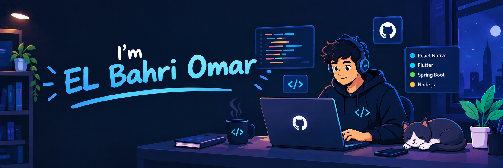

  

 

Hi, I'm [EL Bahri Omar](https://github.com/EL-Bahri-Omar), a mobile and web developer 👨🏻‍💻 from Tunisia. I'm a creative problem solving enthusiast and a product guy, with a constantly growing love for kick ass products. I'm proud to say that **I can succesfully build full-stack applications from UI/UX to deployment.** Beside's Hacking stuff, I play chess ♘ and Football ⚽.
I support **Real Madrid**.

 

### 📢 Find me elsewhere

  &nbsp;&nbsp;&nbsp;

  &nbsp;&nbsp;&nbsp;

- 🎓 I'm currently completing my **Master's degree in Mobile Application Development**;
- 📱 I enjoy building **mobile and web applications**, from UI/UX design to backend APIs, databases and deployment;
- 💻 Ask me about **React Native, Flutter, Spring Boot, React, MongoDB, Firebase, REST APIs and Full-Stack Development**;
- 🎨 I'm interested in **Mobile Development, Full-Stack Development, UI/UX, Cloud & DevOps, and AI-powered applications**;
- ⚙️ Currently building **SmartFactory Manager**, an intelligent industrial monitoring and predictive maintenance platform;
 
 

**Languages and Tools:**
 

<code></code>
<code></code>
<code></code>
<code></code>
<code></code>
<code></code>
<code></code>
<code></code>
<code></code>
<code></code>
<code></code>
<code></code>
<code></code>
<code></code>
<code></code>
<code></code>

---

📈 My GitHub Stats

 

 

<a href="https://github.com/EL-Bahri-Omar">

 

</a>

<strong>Code Cycle</strong>

  

&nbsp;&nbsp;&nbsp;&nbsp;&nbsp;

&nbsp;&nbsp;&nbsp;&nbsp;&nbsp;

### Show some ❤️ by starring some of the repositories!

